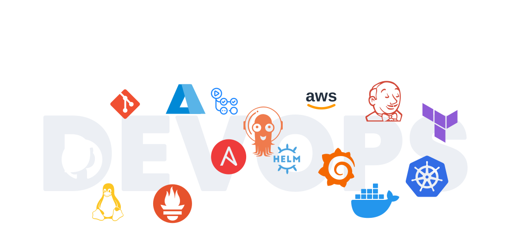

Readme · MD

Hi! I am Jaya Vardhan
Aspiring DevOps Engineer | Cloud Infrastructure | Kubernetes | CI/CD Automation
LinkedIn GitHub Profile views

   

 Ａｂｏｕｔ Ｍｅ 
I'm a B.Tech CSE (Cloud Computing) graduate who builds cloud-native infrastructure that teams can deploy, observe, and trust in production. My focus is automation, reliability, and clean delivery workflows.

Cloud infrastructure: hands-on with AWS, working knowledge of Azure and GCP
Containers: package with Docker and orchestrate on Kubernetes (Helm)
CI/CD: automate delivery with Jenkins, GitHub Actions, Maven, SonarQube, Trivy and Nexus
Infrastructure as code: provision and configure with Terraform and Ansible
GitOps & observability: GitOps workflows, Prometheus and Grafana
Systems: Linux administration and Bash, with a C/C++ and DSA foundation
I enjoy building automation, improving deployment workflows, and learning in public.

Portfolio · LinkedIn · GitHub · Email

🚀 Languages - Frameworks - Tools - Workspace 🚀

  

Featured Projects
Hands-on DevOps and cloud projects covering AWS, CI/CD, Terraform, and Kubernetes. Replace each REPO-NAME with your real repository name.

Project	Focus	Links
End-to-end CI/CD pipeline on AWS	Jenkins, SonarQube, Nexus and Tomcat on four EC2 instances; Maven build, JaCoCo, quality gate, Trivy scan, Nexus publish, WAR deploy, Slack alerts	Code
Terraform: EC2 + Application Load Balancer	Two Apache web servers across separate AZs behind an ALB with target group, listener and health checks	Code
GitHub Actions + EKS pipeline (add once built)	SonarQube, Docker, Trivy, Docker Hub and email notification deploying to EKS	Code
📊 My GitHub Stats

Streak

GitHub stats Top languages

Profile details

Repos per language Most commit language Productive time

3D contribution stats

GitHub activity graph

GitHub trophies

github-snake

⏳ 𝚈𝚘𝚞 𝚑𝚊𝚟𝚎 𝚜𝚝𝚊𝚢𝚎𝚍 𝚘𝚗 𝚖𝚢 𝚙𝚛𝚘𝚏𝚒𝚕𝚎 𝚏𝚘𝚛 ◔_◔ ⌛

<table align="center"> <tr> <td align="center"> ⌚ Front-End</td> <td align="center"> ⚙️ Back-End</td> </tr> </table>  

Claude finished the response
